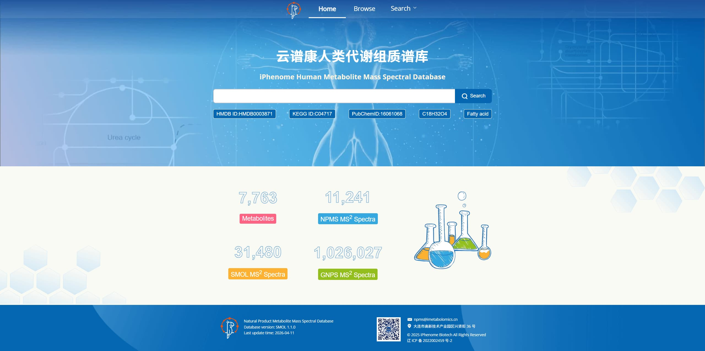

# Humeta Backend

Spring Boot 2.3 + MySQL，提供 Humeta 代谢物检索接口。前端（`../frontend`）通过 axios 调用 `/api/**`。

## 运行

```bash
cd backend
mvn spring-boot:run          # http://localhost:8094
```

- 数据源为 MySQL `humeta` 库的 `metabolite` 表（8160 条）。
- 首次运行：复制 `conf/application.properties.example` 为 `conf/application.properties` 并填写连接信息；
  `application.properties` 含密码，已被 `.gitignore` 忽略。
- 连接信息使用 Spring Boot 标准配置键 `spring.datasource.*`，HikariCP 由自动配置提供
  （`spring.datasource.hikari.maximum-pool-size` 等）。
- ORM 使用 Spring Data JPA（Hibernate 5.4 / `MySQL8Dialect`），`spring.jpa.hibernate.ddl-auto=none`，启动不会修改表结构。
- 结构图：前端 `public/images/structures/{id}.svg`（8160 个），接口 `structureImage` 返回 `/images/structures/{id}.svg`；图片缺失时前端显示占位。
- 打包：`mvn -DskipTests package`。

## REST API

响应统一为 `{ "code": 200, "data": ... }`；出错时 `code` 非 200 并带 `msg`。

### `POST /api/metabolites/search`

多条件分页检索，条件之间为 AND；`queries` 为空时按 id 升序浏览。

```json
{
  "queries": [
    { "keyword": "tryptophan", "field": "name" }
  ],
  "page": 1,
  "size": 20
}
```

`field` 取值：`name`、`id`、`hmdb`、`kegg`、`chebi`、`formula`、`inchikey`、`smiles`。

- `name`：英文名 / 中文名 / 中英文别名包含匹配；
- `id`：Humeta 编号精确或前缀匹配，也匹配 LIPID MAPS / SwissLipids；
- `hmdb` / `kegg` / `chebi` / `formula` / `inchikey`：忽略大小写精确匹配；
- `smiles`：包含匹配。

响应 `data` 为分页结果：

```json
{
  "items": [ ... ],
  "total": 8160,
  "page": 1,
  "size": 20,
  "totalPages": 408
}
```

`page` 从 1 开始，缺省 1；`size` 缺省 20，最大 2000。`total` 为满足条件的总记录数，不受分页影响。
浏览模式由前端按页请求；关键字检索因需要在前端排序与解释，会先取前 1000 条命中结果。

### `GET /api/metabolites/suggestions?keyword=trp&limit=8`

搜索框联想，返回 `label`、`value`、`field`、`category`、`matchType`、`score`；
排序规则：精确 &gt; 前缀 &gt; 包含，名称类优先于编号类。

### `GET /api/metabolites/count`

返回 `metabolite` 表总记录数，例如 `{ "code": 200, "data": { "total": 8160 } }`。

### `GET /api/metabolites/{id}`

按 Humeta 编号查询详情（忽略大小写），例如 `/api/metabolites/IPTM00001E`。
返回结构对齐前端 `metaboliteDetails` 单条记录：

- `id`、`heroLabel`、`name`、`chineseName`
- `overview`：来自 `metabolite_desc` 表，`{ label, value, description: [中文介绍, 英文介绍] }`；无介绍记录时为 `null`
- `identifiers`：Humeta 编号、CAS、PubChem、HMDB、KEGG、LIPID MAPS、SwissLipids、ChEBI、缩写、同义词等
- `chemicalDescription`：分子式、质量、IUPAC、InChIKey、SMILES、描述符、结构图
- `taxonomy`：Humeta Classification System + Classyfire System 两棵树

返回 `metabolite` 与 `metabolite_desc` 能提供的数据；`spectra`、`tissueDistribution`、
`biofluidConcentrations`、`trajectories`、`diseaseAssociation`、`pathway` 等表内没有的区块不返回。
未找到返回 HTTP 404。

## 代码结构

| 路径 | 说明 |
|---|---|
| `controller/MetaboliteController` | REST 接口 |
| `service/MetaboliteService` | 检索、联想排序、DTO 映射 |
| `repository/MetaboliteRepository` | Spring Data JPA 仓库（`JpaRepository` + `JpaSpecificationExecutor`） |
| `repository/MetaboliteSpecifications` | 多条件检索与联想的 Criteria 条件 |
| `entity/MetaboliteEntity` | JPA 实体，映射 `metabolite` 表 |
| `entity/MetaboliteDescEntity` | JPA 实体，映射 `metabolite_desc` 表 |
| `repository/MetaboliteDescRepository` | 中英文介绍仓库 |
| `dto/MetaboliteDto` | 与前端 `MetaboliteSearchRecord` 对齐 |
| `dto/SuggestionDto` | 与前端 `SuggestionItem` 对齐 |
| `config/SpringMvcConfig` | 静态资源与 `/api/**` CORS |

## 数据导入

### 代谢物中英文介绍（md Overview -> MySQL）

`scripts/import_overview_md.py` 读取 `md Overview/*.md`（文件名即 Humeta 编号，
第一行为中文介绍、第二行为英文介绍），按 id upsert 到 MySQL 表
`metabolite_desc(id, desc_cn, desc_en)`。

```bash
pip install pymysql
# 先填写脚本顶部的 DB_HOST / DB_USER / DB_PASSWORD，或设置 HUMETA_DB_* 环境变量
python scripts/import_overview_md.py --dry-run   # 只解析预览
python scripts/import_overview_md.py             # 写入数据库
```

### 历史脚本（SQLite）

`metabolite` 表的数据已迁移到 MySQL，应用运行不依赖该脚本。
`scripts/import_humeta_csv.py` 仅用于从 CSV 重建本地 SQLite 源库（单表 `metabolite`，列名与 CSV 表头一致）。

```bash
python scripts/import_humeta_csv.py [csv] [db]
```

## 前端联调

```bash
cd ../frontend
npm install
npm run dev                  # http://localhost:5173，/api 代理到 127.0.0.1:8094
```

接口前缀可通过 `VITE_API_BASE_URL` 覆盖（默认 `/api`），见 `src/services/api/client.ts`。

